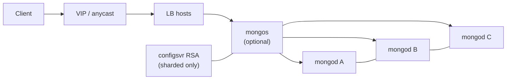
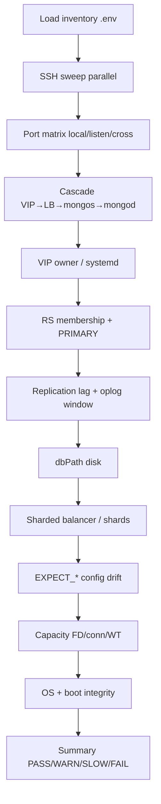

# MongoDB HA health-check architecture

## Topology (typical)

Pure replica set: leave `VIP_HOST` / `LB_HOSTS` / `MONGOS_HOSTS` empty; clients hit `MONGOD_HOSTS:27017`.

## Check flow

## Severity

| Status | Meaning | Exit contribution |
|--------|---------|-------------------|
| PASS | Healthy / expected | 0 |
| WARN | Degraded or checker gap | 1 |
| SLOW | Worked but slow SSH | 1 |
| FAIL | Availability/correctness broken | 2 |
| INFO | Context | 0 |
| SKIP | Prerequisite missing | 0 |

## Toolkits in this directory

1. **`./run_all.sh`** — orchestrator over suites (`--only ha` today).
2. **`./check_mongo_ha.sh`** — inventory-driven multi-node HA check (skill `ha-cluster-healthcheck`); tasks via `--only` / `--skip`.

Deep single-node admin suites (if added later) belong in `run_admin_suite.sh`, not `run_all.sh`.
